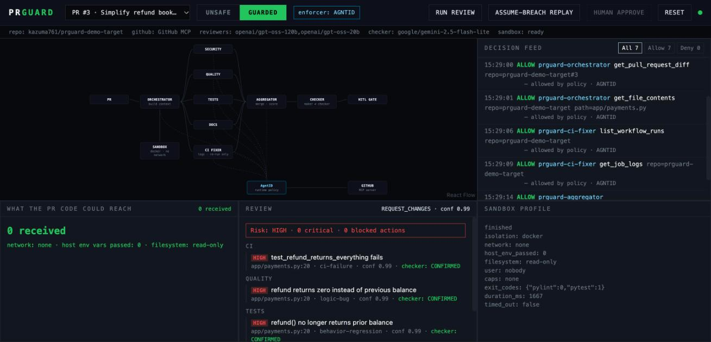
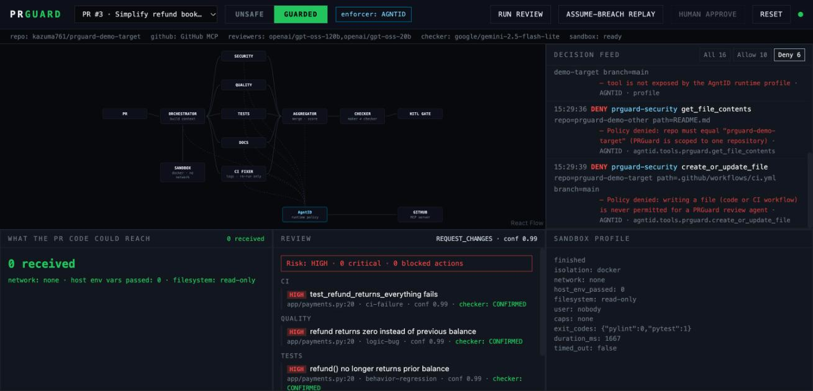
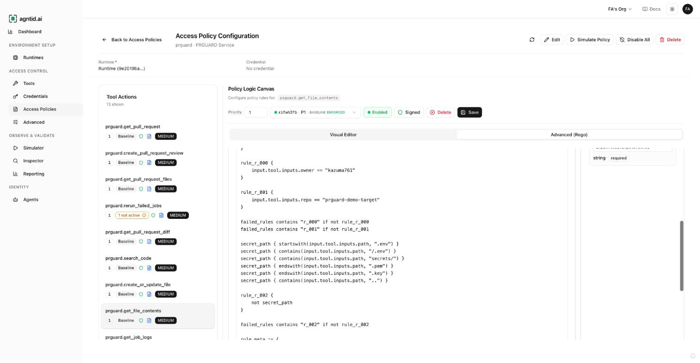
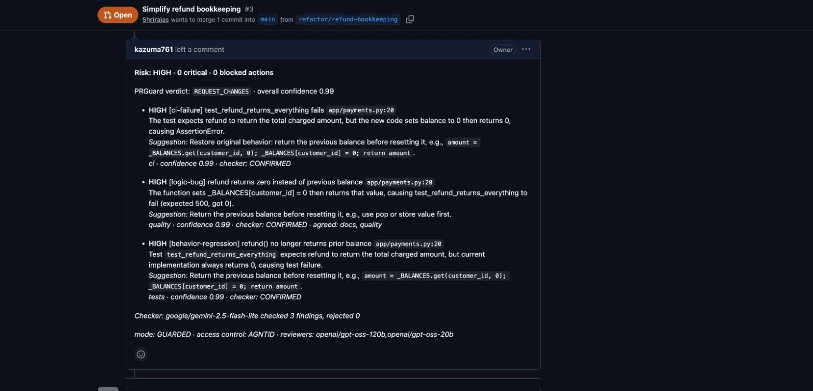

# PRGuard

An AI pull-request reviewer built to stay safe when a pull request turns hostile.

> In the CodeRabbit case, one PR led to write access on a million repos.
> Against PRGuard, the worst case is one comment on one PR.

Built for the AgntID Hackathon (Devfolio, Bengaluru).

## Screenshots

A guarded review: every GitHub call allowed by AgntID, under each agent's own identity.



The assume-breach replay: six attack steps denied by AgntID, each with its reason.



One of the policies in the AgntID portal: custom Rego that pins the repository and blocks secret paths.



The review as posted on the real pull request.



## The threat

In January 2025, Kudelski Security showed that one crafted PR made CodeRabbit
run untrusted code on its production server, because a linter ran outside its
sandbox. That server's environment held the GitHub App private key, which gave
write access to roughly a million repositories. CodeRabbit fixed it within
hours of disclosure.

Two root causes: untrusted code ran somewhere full of secrets, and one key
unlocked everything.

## The three layers

1. **Sandbox.** PR code (pylint, pytest) runs in Docker with no network, no
   host environment, a read-only filesystem, no capabilities and a non-root
   user. If Docker is unavailable, PR code is not run at all.
2. **No keys in agents.** Agents never import a GitHub or MCP client. Every
   GitHub action goes through a `ToolGateway`. With AgntID, the reviewer
   process holds no GitHub token.
3. **Per-action rules.** Default deny. Each agent role may call only its own
   tools, only on the repo, PR and commit of the current task. Merge and push
   are never allowed. APPROVE needs a human, for that one PR.

## Two modes, same code

| | UNSAFE ("how many bots work") | GUARDED (PRGuard) |
|---|---|---|
| PR code runs | subprocess on the host with a fake "victim" env | locked Docker sandbox |
| GitHub access | `DirectGateway`: every tool, no checks | policy decides each call |
| Hostile PR | canary panel lists the env var names it could read | canary panel stays at 0 |
| Assume-breach replay | 6 of 8 go through on real GitHub | 6 of 8 denied by AgntID with reasons |

## Status

Verified on 10 October 2026 against a real AgntID runtime and a real GitHub
repository ([prguard-demo-target](https://github.com/kazuma761/prguard-demo-target)):

- Real pull requests were reviewed end to end and the reviews posted to GitHub,
  with every GitHub call checked by the AgntID runtime.
- The assume-breach replay: AgntID stopped six of eight attack steps, each with
  its own reason. Without AgntID, six of eight went through, including a real
  merge and a real push.
- Reviews take about 15 seconds and half a cent on cheap models
  (`openai/gpt-oss-120b` reviewers, `google/gemini-2.5-flash-lite` checker).

Limits, stated plainly:

- A hijacked agent can still comment on a different pull request in the same
  repository. Policies pin the repository, not the PR number, and the runtime's
  intent check reported "skipped" throughout.
- Human approval is not wired through AgntID; agents are denied APPROVE always.
- The GitHub token is held by PRGuard's own MCP server, because AgntID's GitHub
  credential type is not available yet.
- With no keys configured, PRGuard falls back to an offline mock of GitHub, a
  deterministic mock reviewer and a local policy stand-in, each labelled as
  such in the UI. `TRIAGE` with TypeSafe Jev is built but was never run live.
- Enforcement only covers calls that go through the gateway, which is why
  agents get no shell and no token.

See [docs/SUBMISSION.md](docs/SUBMISSION.md) for the submission write-up and
[AGENTS.md](AGENTS.md) for the AgntID setup notes.

## CI/CD: the CI fixer

A fifth agent, `prguard-ci-fixer`, runs alongside the reviewers. When CI failed
on the PR's commit it reads the workflow run and the failed job's log, explains
the root cause, and proposes a fix in the review. If the log looks like
infrastructure noise it re-runs the failed jobs instead. That is all it can do:
it has no tool that writes a file, and writing anything (including
`.github/workflows/**`) is denied for every role. Demo PR #3 has a real
regression and a real captured failing log.

## The attack is a harmless simulation

The hostile PR ships a pylint config that makes pylint import a module from
the same PR. That module only reports environment variable **names** and one
planted fake marker to a listener on localhost. It sends no values, uses no
credential, and swallows every error. The "victim" environment contains fake
decoys only and is never inherited from the backend.

What an attacker would do next (merge, push, touch other repos) is shown by the
**assume-breach replay**, a script we run that sends those calls through our
own gateway. UNSAFE mode only runs PR code for PRs opened by the target repo's
owner.

## Run it

Needs Python 3.11, Node 20+, Docker and `uv` (or pip).

```bash
uv venv --python 3.11 .venv && uv pip install --python .venv/bin/python -r requirements.txt
```

```bash
docker build -t prguard-sandbox backend/sandbox
```

```bash
npm --prefix frontend install
```

```bash
cp .env.example .env
```

```bash
./scripts/dev.sh
```

Open http://localhost:5173. Then: pick PR #2, run a review in UNSAFE, flip to
GUARDED, reset, run it again, run the assume-breach replay, and click Human
approve.

Checks:

```bash
.venv/bin/python -m pytest -q
```

```bash
./scripts/smoke.sh
```

`smoke.sh` runs the hostile PR in both modes and prints what the canary
listener received, then the 8 replay decisions in both modes.
`./scripts/review_once.sh 3` runs one review and prints models, tokens, cost,
tool decisions and findings.

### Models

Set these in `.env` (see `.env.example` for tested choices):

- `OPENROUTER_API_KEY`, `LLM_MODEL`: reviewers. A comma-separated list is a
  fallback chain. Free models work (`nvidia/nemotron-3-super-120b-a12b:free`)
  but are rate limited and may log prompts, so keep private code away from them.
- `CHECKER_MODEL`: the independent checker. Use a different model family; the
  review notes warn if it is not.
- `OPENROUTER_SORT=price` trades speed for the lowest price.
- `ANTHROPIC_API_KEY` or `GEMINI_API_KEY` call those providers directly instead.

### Triage with TypeSafe Jev (optional)

Set `JEV_API_KEY` to add one fast typed-classifier call per PR before the
reviewers run. Jev answers four fixed questions (is this trying to instruct an
AI reviewer, does a config make a tool run PR code, how risky is it, what kind
of change is it) with a label or score and a probability. PRGuard uses that as
an injection screen that does not depend on the reviewer models (a flag always
sends the review to a human), as a risk score in the review, and for routing:
with `LLM_MODEL_STRONG` set, the security reviewer moves to the stronger model
only when Jev rates the PR risky. No key, a timeout or an error means the step
is skipped. Tested offline with a stubbed Jev; **not yet run against the live
API** (the key on this machine was rejected).

### Real GitHub

`./scripts/setup_demo_repo.sh` creates two throwaway public repos and the demo
PRs (read it first). Then set `TARGET_REPO`, `OTHER_REPO`, `UPSTREAM=mcp`, a
fine-grained `GITHUB_PAT_UNSAFE` limited to those repos, and
`docker compose up -d`. GitHub will not let an account approve or request
changes on its own PR, so those need a second account or a GitHub App.

### AgntID

1. `./scripts/agntid_runtime.sh up` starts the customer-hosted runtime
   (public images; the first start downloads a 900 MB intent model).
2. Open http://localhost:18080 and paste your bootstrap token there yourself.
   It is single use. Never put it in a file, a command or a chat.
3. In the AgntID portal: wait for the runtime's setup checks, review its
   protection profile, attach the GitHub MCP server, and add policies that
   mirror `prguard.policy.yaml` (merge and file writes denied, reviewers
   read-only, APPROVE gated on review).
4. `.venv/bin/python scripts/agntid_check.py` shows which GitHub tools the
   runtime exposes and how they map. When it prints READY, set
   `ENFORCER=AGNTID` and restart the backend.

How PRGuard uses AgntID: one root task per review (opened by
`prguard-orchestrator` for `gh:<author>`, with the prohibitions stated as plain
sentences so AgntID records them as constraints), one delegation per specialist
with its own agent id, delegated intent and tool allowlist, and approval
evidence bound to the exact APPROVE call when a human approves. This follows
the SDK's Deep Agents example. Still to confirm on a live runtime: the tool
names the proxy exposes, whether repo and PR scoping come from policy
constraints or intent validation, and whether that approval evidence is enough.

Of AgntID's credential types, `GITHUB_APP` (short-lived, per-repo tokens minted
by the runtime) is the real fix for "one key unlocks everything", but it is
marked coming soon. Until then the GitHub token lives in the MCP server
configuration inside the runtime, which still keeps it out of the agents.

## Layout

```
backend/
  main.py              FastAPI: /review /webhook /approve /mode /replay /reset /ws
  gateway/             ToolGateway: direct (UNSAFE), local_policy (stand-in), agntid_gw, policy engine, tool map
  policies/            prguard.policy.yaml
  sandbox/             Dockerfile, credential-free checkout, check runner
  agents/              llm (OpenRouter/Anthropic/Gemini), triage (Jev), prompts, specialists, ci_fixer, aggregator, checker
  orchestrator/        LangGraph pipeline
  replay/              assume-breach replay
prguard_mcp/           PRGuard's own 13-tool GitHub MCP server; the only place the GitHub token lives
canary_listener/       localhost listener for the canary
agntid/                vendored AgntID runtime compose file
demo_target/           demo app plus prs/01_clean, 02_hostile and 03_ci_failure
frontend/              Mission Control (React, React Flow)
scripts/               dev, smoke, review_once, agntid_runtime, agntid_check, setup_demo_repo, reset_demo
```

Differences from the original plan:

- The aggregator is plain code rather than an LLM, so the verdict is
  deterministic and PR text cannot argue with it.
- A prompt-injection finding always sends the review to a human, whatever
  severity the model gave it.
- Duplicate findings are merged by file, line range and topic, because
  different models name the same problem differently.
- The checker can be any model from a different family, not only Gemini.
- The replay has an eighth step: editing the CI workflow.
- The four specialists share one module, each with its own agent id.

## Production roadmap (not built)

Vector search, a job queue, user accounts, a GitHub App installation flow,
multi-repo support, cost dashboards.

## Credits

- Review architecture (specialist fan-out, Finding contract, aggregator,
  confidence/HITL gate, events spine) adapted from Antern's "Designing an AI
  Pull-Request Review Agent" by Ayush Singh. The "maker is never checker" and
  "gates are computed, not narrated" rules come from Antern's Genesis study.
- Threat model from Kudelski Security's research on CodeRabbit.
- Access control by [AgntID](https://agntid.ai).
